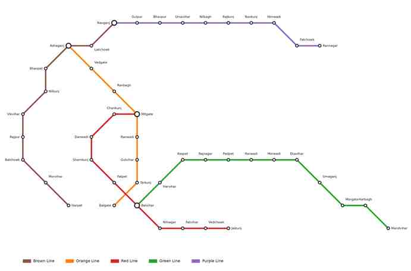
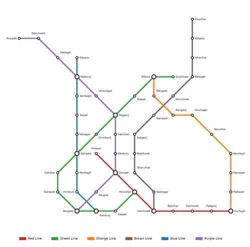
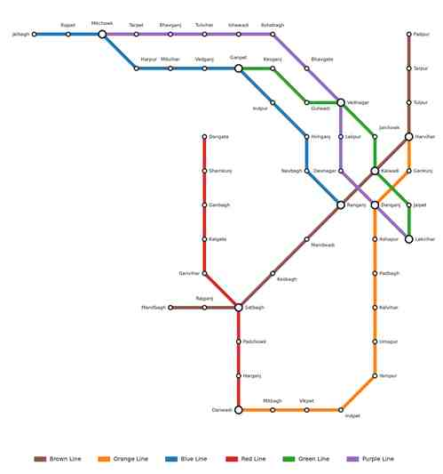
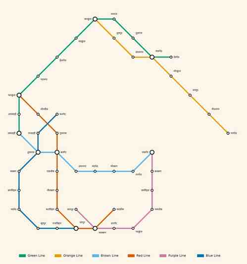

# Failure gallery: claude-sonnet-5-5 low-res (chat-session)

43 wrong answers; 8 shown, spread over skills. Images are exactly what the model saw.

## m0000-0 (route_planning, latin names, 5 lines)

**Question:** What is the minimum number of interchanges (changes of line) needed to travel from Morvihar to Navganj? Answer with a number.

**Model replied:** `1`

**Reference answer:** `0`

## m0000-3 (line_tracing, latin names, 5 lines)

**Question:** On the Green Line, how many stations are strictly between Balvihar and Harwadi? Do not count Balvihar or Harwadi. Answer with a number.

**Model replied:** `0`

**Reference answer:** `4`

## m0001-1 (counterfactual_reasoning, latin names, 6 lines)

**Question:** Suppose the Red Line is closed and cannot be used at all. What is the minimum number of interchanges needed to travel from Balpet to Himchowk? Answer with a number, or the word 'impossible' if there is no route.

**Model replied:** `0`

**Reference answer:** `impossible`

## m0001-2 (interchange_identification, latin names, 6 lines)

**Question:** Which lines stop at Himvihar? List every line colour, separated by commas.

**Model replied:** `Blue`

**Reference answer:** `Green, Red`

## m0001-4 (legend_matching, latin names, 6 lines)

**Question:** At which station do the Green Line and the Orange Line meet? Answer with the station name.

**Model replied:** `Milkunj`

**Reference answer:** `Nilkunj`

## m0005-0 (route_planning, latin names, 6 lines)

**Question:** What is the minimum number of interchanges (changes of line) needed to travel from Dangate to Devnagar? Answer with a number.

**Model replied:** `3`

**Reference answer:** `2`

## m0005-4 (legend_matching, latin names, 6 lines)

**Question:** At which station do the Blue Line and the Brown Line meet? Answer with the station name.

**Model replied:** `Rangaly`

**Reference answer:** `Ranganj`

## m0007-2 (interchange_identification, devanagari names, 6 lines)

**Question:** Which lines stop at फतकुंज? List every line colour, separated by commas.

**Model replied:** `Red`

**Reference answer:** `Green, Red`
